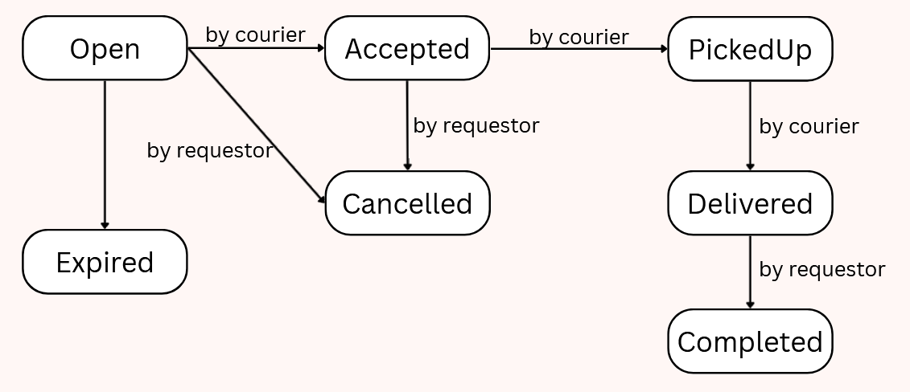

# Order service

Owns errand creation and lifecycle state. Uses Node 24, Express and PostgreSQL.

From the repository root, run `docker compose up --build`. The service is at
`http://localhost:3003`, credit-service is at `http://localhost:3004`, and the
browser gateway forwards `/api/order/orders` to this service. `GET /health` is public.
The order tables are created on startup; existing data is preserved.

Every `/orders` request needs the `relay_session` cookie from user-service login.
Order-service asks user-service to authorize the session as a member, then uses
the returned account id. Supplier and credit HTTP requests forward the same cookie.

Creation checks `/suppliers/{id}/availability?at=<neededByTime>`, so a missing,
inactive or closed supplier is a field error on `supplierId`. A refusal names every
invalid field at once in `error.details.fields`. The service then saves a Pending
order, reserves the reward through `POST /credits/reserve` and opens the order once
the reservation is confirmed. When the credit service refuses (`INSUFFICIENT_CREDITS`,
`CREDIT_RESERVATION_REFUSED`) or does not answer within 5 seconds
(`CREDIT_SERVICE_TIMEOUT`), the order becomes Rejected. A Rejected or Pending order is
no errand: no endpoint shows it, and retrying the POST is safe. Only Open orders appear
in `GET /orders/open` and can be accepted.

## Schema


**Walking route (nice-to-have).** The drop-off needs both the address typed by the
requester (`deliveryLocation`) and the point picked on the map (`deliveryLatitude`,
`deliveryLongitude`). The web client measures the walk as soon as the supplier and the
point are chosen, to show it before posting. Creation then
measures it again from the same supplier-service endpoint (`POST /suppliers/{id}/route`,
the point in the body so no access log keeps it), so a client cannot store a distance
of its own. The errand stores both ends and the walk: `pickup_latitude`,
`pickup_longitude`, `delivery_latitude`, `delivery_longitude`, `route_metres`,
`route_seconds` (the metres at the supplier-service's walking speed of 1.3 m/s) and
`route_estimated`, true when the point is off the walking map and the walk is a
straight-line estimate. The route is an extra, so when it cannot be measured, for
example because the supplier has no map location or the supplier-service does not
answer within 2 seconds, the errand is still created and the route columns stay null.
Errands from before have null in all seven columns.

Every error is `{ "error": { "code", "message", "details" } }`, the shape the web
client reads.

| Method | Path | Purpose |
| --- | --- | --- |
| POST | `/orders` | Create with `supplierId`, `deliveryLocation`, `deliveryLatitude`, `deliveryLongitude`, `neededByTime`, `itemLines`, `creditReward` |
| GET | `/orders/open` | Browse open orders |
| GET | `/orders/:id` | Read an errand with the caller's `allowed_transitions`. An Open errand is visible to every member, any other only to its requester and courier |
| POST | `/orders/:id/accept` | Assign the authenticated courier |
| PATCH | `/orders/:id/status` | `{ "status": "PickedUp" }`; only `PickedUp`, `Delivered`, `Completed` or `Cancelled`, anything else is a field error |
| GET | `/orders/mine` | Own errands as requester or courier, newest first, with history, `role` and `allowed_transitions` |
| GET | `/orders/admin` | Retrieve orders for Admin viewing only |

`GET /internal/orders/:id` answers `{ id, requesterId, courierId, status }` for other
services, or 404. The gateway does not forward it, so only the compose network and the
cluster reach it.

## Order lifecycle

An errand follows a defined lifecycle, with different operations available depending on its current status.

### Order creation

Creating an errand requires:

`supplierId`

`deliveryLocation`

`deliveryLatitude`

`deliveryLongitude`

`neededByTime`

`itemLines`

`creditReward`

Before creating the errand, the service checks the selected supplier's availability through: `GET /suppliers/{id}/availability?at={neededByTime}` The supplier must exist, be active and be open at the requested time. A missing, inactive or closed supplier results in a validation error associated with supplierId.

The service validates all relevant input fields together. When validation fails, the response identifies every invalid field in error.details.fields. Once the validation succeeds, the service:

1. Saves the order with Pending status.

2. Requests a reward reservation through POST /credits/reserve.

3. Waits for the reservation result.

4. Changes the order to Open once the reservation is confirmed. If the Credit Service refuses the reservation or does not respond within five seconds, the order becomes Rejected.


>Pending and Rejected orders are not exposed through the user-facing order endpoints, but can be viewed by admin in the Admin Dashboard. Only Open orders are available for browsing and acceptance.

Retrying the creation request is safe when the previous attempt resulted in a Pending or Rejected order.

Completed requests a credit transfer to the assigned courier. Cancelled, Expired and Rejected request release to the requester (Rejected as `order.errand.cancelled`). These use a transactional PostgreSQL outbox and RabbitMQ; a credit or broker outage leaves the event waiting for retry. Each instance claims a batch for 30 seconds before it sends it, so several replicas never send the same event twice in normal operation. The credit consumer reuses its existing idempotent transfer/release operations. See [the event catalog](../docs/events.md). The broker publisher follows `user-service/src/broker.ts` from this repository.

A release closes its errand reference in credit-service even if it arrives before reservation. A Pending order left by a crash is rejected after one minute. An Open order that nobody accepted by its needed-by time is set to Expired automatically, which releases its reward.

Order status transitions

| Status | Description |
|--------|-------------|
|Pending | The order has been created and is awaiting credit reservation
| Open |The reward has been reserved and the errand is available for acceptance
| Accepted |A courier has accepted the errand
|PickedUp |The courier has picked up the requested items
|Delivered |The items have been delivered
|Completed |The errand has been completed
|Cancelled |The errand has been cancelled
|Rejected |The credit reservation was refused or timed out
|Expired |The errand was not accepted before its needed-by time



## Local development
For local development, run the dependencies in Compose, set the variables in the root `.env.example`, then run `npm ci` and `npm run dev` in `order-service`. Run the type check and the tests in `order-service`:

```sh
npm run typecheck
npm test
```

## Declaration of AI-assisted work

Architecture and schemas, workflow are human-made. Below are AI-assisted actions:

**Debug:** Claude was used to debug the issues of Order Service not being able to receive/correctly parse information from Supplier Service
**Generate:** Claude was used to generate the Order Life Cycle in this document
